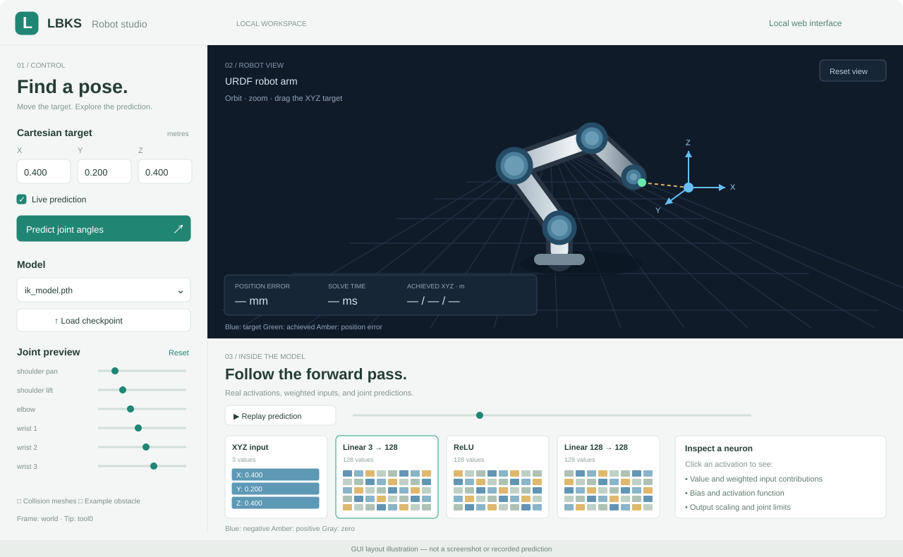

# LBKS · Learning-based inverse kinematics

Train an IK network and explore robot poses in a local web GUI.


*GUI layout illustration, not a screenshot.*

Requires ROS 2 Jazzy and `~/purdue_ws/venv` with `torch`, `pytorch-kinematics`, and
`PyYAML`. The current trainer uses CUDA.

## 1. Build

```bash
cd ~/purdue_ws
source /opt/ros/jazzy/setup.bash
colcon build --packages-select lbks_description lbks_planner lbks_gui
source install/setup.bash
```

## 2. Train

```bash
cd ~/purdue_ws
source install/setup.bash
ros2 launch lbks_planner train.launch.py
```

Saves the trained weights to `~/purdue_ws/ik_model.pth`.

## 3. Visualize IK

```bash
cd ~/purdue_ws
source install/setup.bash
ros2 launch lbks_gui visualize.launch.py \
  python_executable:="$HOME/purdue_ws/venv/bin/python"
```

Open **http://127.0.0.1:8080**, then:

1. Click **Load checkpoint** and select `ik_model.pth`.
2. Enter XYZ coordinates or drag the blue target to predict a robot pose.
3. Inspect the position error and replay the network’s activations below the robot.

Use **Numerical IK** to try the GUI without a trained model. Joint sliders and
collision-mesh toggles are also available; collision detection is not implemented.

See [GUI details](lbks_gui/README.md) for model variants and configuration.
