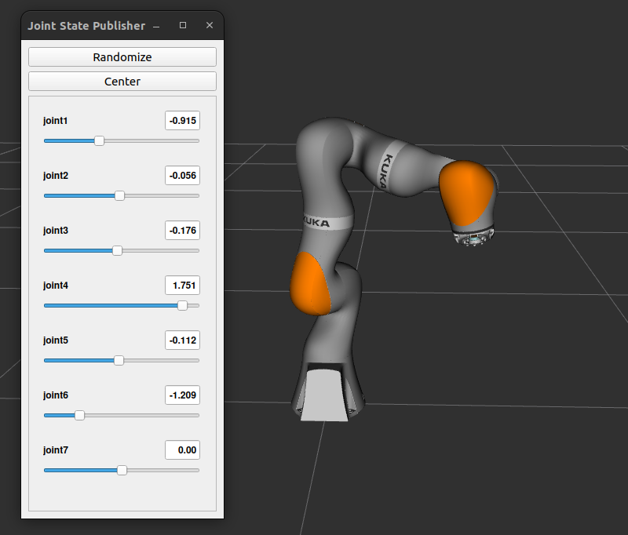
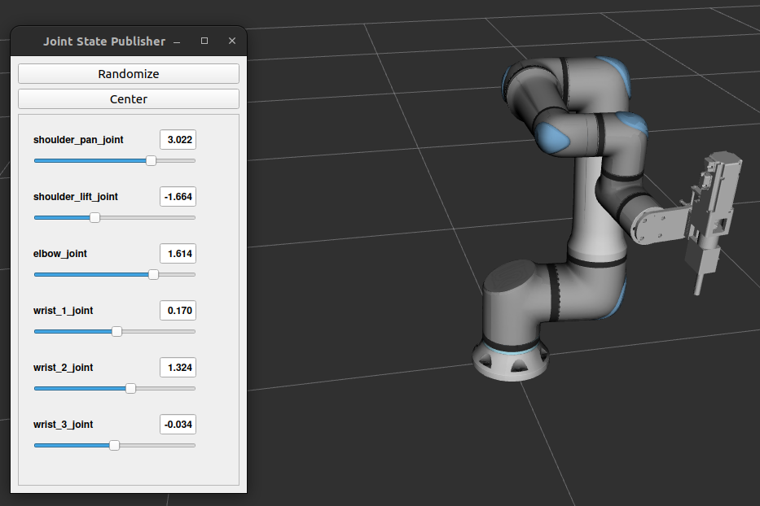

# lbks_description
description for UR & Kuka robot arm

## To visualize the ur robot
``` ros2 launch lbks_description visualize_robot_ur.launch.py ```

## To visualize the kuka robot
``` ros2 launch lbks_description visualize_robot_kuka.launch.py ```



